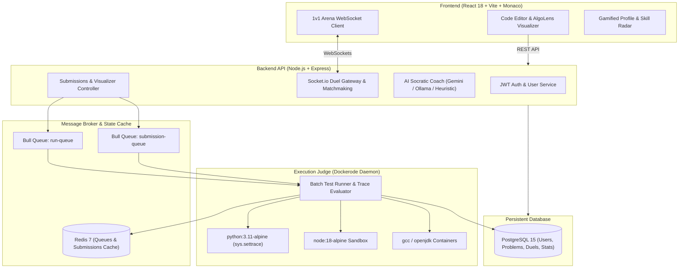

# CodeArena — Next-Generation Competitive Programming & Interview Platform

<div align="center">


**An ultra-modern, gamified LeetCode clone featuring an AI Socratic Coach, Live 1v1 Multiplayer Code Duels, an AlgoLens Line-by-Line Execution Stepper, and an Algorithmic Skill Radar.**

[Key Features](#key-features) • [System Architecture](#system-architecture) • [Quick Start](#quick-start) • [Default Credentials](#default-credentials) • [API Overview](#api-overview)

</div>

---

## 🌟 Key Features

### 1. ⚔️ Live 1v1 Multiplayer Code Duels Arena
- **Real-Time Speed Battles:** Queue up against other engineers or create private custom rooms via shareable 6-character room codes.
- **Dual Live Progress Bars:** Watch your opponent's test case progress in real-time over WebSockets (`Socket.io`) as you both code.
- **Elo Rating & W/L Tracking:** Win matches to climb the global Elo leaderboard; ratings automatically calculate after every match.
- **Confetti Victory Celebrations:** Interactive celebration modal with match statistics, execution runtime delta, and rematch options.

### 2. 🔍 AlgoLens — Interactive Line-by-Line Code Visualizer
- **Execution Stepper:** Step forward/backward through your code execution or press **Play** with adjustable speeds ($0.5\times$, $1\times$, $2\times$).
- **Visual Array & Pointer Radar:** Automatically tracks integer pointers (`i`, `j`, `left`, `right`, `mid`) and renders animated pointers pointing directly to array elements as they move.
- **Live Call Stack & Scope Table:** Inspect recursion frames as functions push/pop from the stack, and monitor Hash Maps/Dictionaries in real-time.
- **Crash & Infinite Loop Protection:** Capped execution trace engine captures exact line and variable state on unhandled exceptions or loops.

### 3. 🧠 AI Socratic Coach & Big-O Complexity Analyzer
- **Dual-Engine Architecture:** Powered by Google Gemini 2.0 Flash / local Ollama with a deterministic AST heuristic fallback.
- **Instant Complexity Audit:** Predicts Time and Space complexity ($O(N)$, $O(N \log N)$, $O(N^2)$) and breaks down loop nesting depth, recursion overhead, and memory allocations.
- **3-Tier Progressive Hint Disclosure:** Reveal conceptual intuition first, pseudocode logic second, and edge-case handling third—without spoiling the final answer.
- **Socrates AI Chat:** Ask clarifying algorithmic questions directly in the IDE side panel.

### 4. 📊 Gamified Developer Profile & Algorithmic Skill Radar
- **Hexagonal SVG Skill Radar:** Zero-dependency, responsive 6-pillar radar chart mapping mastery in:
  - *Dynamic Programming*
  - *Data Structures*
  - *Strings & Text*
  - *Two Pointers & Search*
  - *Math & Logic*
  - *Greedy & Sorting*
- **GitHub-Style 365-Day Activity Heatmap:** Emerald density squares tracking daily submissions over the past year.
- **Streak & Velocity Counters:** Live tracking for **Current Active Streak** (with flame animation) and **Longest Streak**.
- **Unlockable RPG Badges:** Earn shiny badges (*First Blood, Speed Demon, DP Sorcerer, Arena Gladiator, Code Centurion, Grandmaster, Streak Flame*) with Bronze, Silver, Gold, Diamond, and Master tiers.

### 5. ⚡ High-Performance Sandboxed Execution Judge
- **Batch Evaluation Session:** Evaluates public and hidden test cases in a single in-memory container session, eliminating container restart overhead.
- **Multi-Language Support:** First-class support for **Python 3**, **JavaScript (Node.js)**, **Java 17**, and **C++ (GCC)**.
- **Resource Constraints:** Strict sandboxing with memory limits ($256\text{ MB}$), CPU throttling, non-root user execution, and network isolation.

---

## 🏗️ System Architecture



---

## 🚀 Quick Start (Docker 1-Command Startup)

### Prerequisites
- [Docker Desktop](https://www.docker.com/products/docker-desktop/) (running on Windows, macOS, or Linux)
- [Git](https://git-scm.com/)

### 1. Clone the Repository
```bash
git clone https://github.com/your-username/leetcode-clone.git
cd leetcode-clone
```

### 2. Configure Environment Variables (Optional)
Create a `.env` file in the root directory (defaults are already configured in `docker-compose.yml`):
```env
GEMINI_API_KEY=your_gemini_api_key_here   # Optional: For AI Coach Gemini mode
OLLAMA_URL=http://host.docker.internal:11434 # Optional: For local Ollama mode
```

### 3. Launch with Docker Compose
```bash
docker compose up -d
```

All 5 microservices will spin up:
- **Frontend Web UI:** `http://localhost:5173`
- **Backend API:** `http://localhost:3000`
- **Execution Engine:** `http://localhost:3001`
- **PostgreSQL Database:** `localhost:5433` (mapped from container `5432`)
- **Redis Cache:** `localhost:6379`

---

## 🔑 Default Credentials

The database is pre-seeded with full datasets, test cases, and administrative accounts:

| Role | Email | Password | Privileges |
| :--- | :--- | :--- | :--- |
| **Administrator** | `admin@codearena.com` | `admin123` | Full problem CRUD, test case creation, stats management |
| **Test Engineer** | `test@example.com` | `test123` | Duel arena access, submissions, profile tracking |

---

## 📡 API Overview

### Submissions & Execution
- `POST /api/submissions/run` — Run code against sample/custom test cases (instant, non-official).
- `GET /api/submissions/run/:runId` — Poll status/results of a sample test run.
- `POST /api/submissions` — Submit code against full hidden test suite.
- `POST /api/submissions/visualize` — Trace step-by-step code execution via AlgoLens.
- `GET /api/submissions/visualize/:traceId` — Fetch execution trace steps, memory snapshots, and call stacks.

### 1v1 Arena Duels
- `GET /api/duels/leaderboard` — Fetch top players ranked by Elo rating.
- `GET /api/duels/stats` — Fetch player's personal win/loss match history.
- `WebSocket /arena` — Real-time duel matchmaking queue, room join, and test case progress broadcast.

### AI Socratic Coach
- `POST /api/ai/analyze-complexity` — Instant Big-O Time & Space complexity analysis.
- `POST /api/ai/hint` — Progressive 3-tier hints for the current problem.
- `POST /api/ai/review` — Complete algorithmic and stylistic code audit.
- `POST /api/ai/chat` — Conversational Socratic dialogue without code spoilers.

### Users & Gamified Profiles
- `GET /api/users/:userId/stats` — Fetches 6-pillar Skill Radar, 365-day submission heatmap, current/longest streaks, and unlockable RPG badges.
- `GET /api/users/leaderboard` — Global problem-solving leaderboard.

---

## 🛠️ Tech Stack Breakdown

- **Frontend:** React 18, TypeScript, Vite, Monaco Editor, Tailwind CSS, Lucide Icons, Canvas Confetti, React Query, Zustand.
- **Backend:** Node.js, Express, TypeScript, Socket.io, Bull Queue, Zod, JWT, Winston.
- **Execution Judge:** Dockerode, Alpine Linux sandbox images (`python:3.11-alpine`, `node:18-alpine`, `openjdk:17-alpine`, `gcc:13-alpine`).
- **Data Stores:** PostgreSQL 15, Redis 7.

---

## 📄 License

This project is licensed under the [MIT License](LICENSE).
